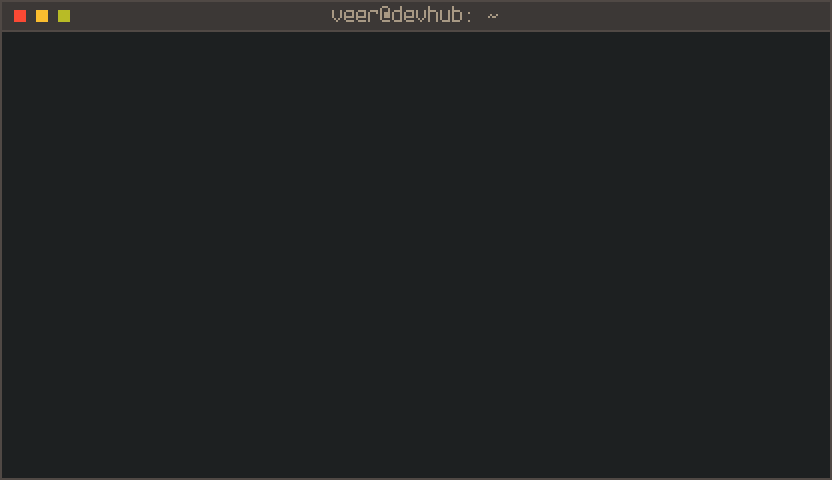
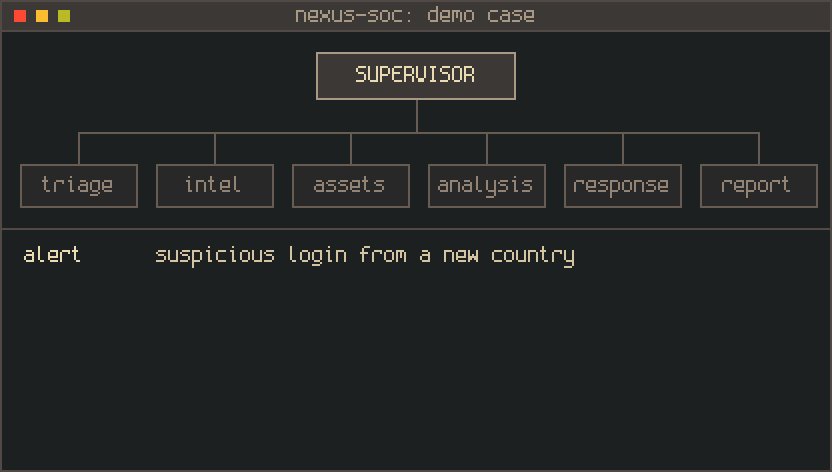
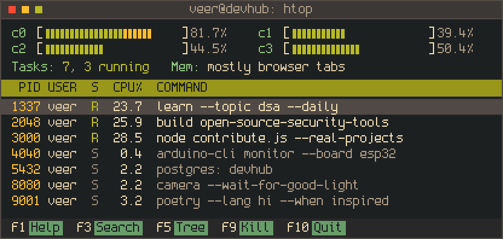
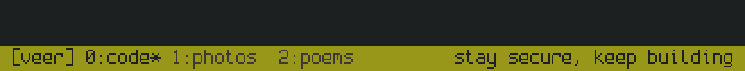

### `$ cat links.txt`

<pre>
portfolio   <a href="https://veerpratapsingh-one.vercel.app">veerpratapsingh-one.vercel.app</a>
email       <a href="mailto:veerprataps.ranawat@gmail.com">veerprataps.ranawat@gmail.com</a>
code        <a href="https://github.com/VeerDev-hub?tab=repositories">github.com/VeerDev-hub</a>
</pre>

### `$ ./nexus-soc --demo`

**[NEXUS-SOC](https://github.com/VeerDev-hub/NEXUS-SOC)** is a security operations center where seven AI agents investigate each alert and humans decide what happens next. Risky actions wait for a person to approve them.

### `$ ls ~/projects`

<pre>
security/
├── <a href="https://github.com/VeerDev-hub/NEXUS-SOC">NEXUS-SOC</a>          multi-agent SOC with human approval
├── <a href="https://github.com/VeerDev-hub/IntrusionBench">IntrusionBench</a>     intrusion detection benchmark, 4 datasets, 5 models
└── <a href="https://github.com/VeerDev-hub/port-scanner-webapp">Recon Console</a>      port scanner with hand-built packets, CLI and web

web/
├── <a href="https://github.com/VeerDev-hub/Analytica-2.0">Analytica Studio</a>   explore, clean and prepare data for ML
├── <a href="https://github.com/VeerDev-hub/Klaro">Klaro</a>              chat with any document, answers are cited
└── <a href="https://github.com/VeerDev-hub/VITAP-Connect">VITAP Connect</a>      find teammates and run projects at VIT-AP

ai/
└── <a href="https://github.com/VeerDev-hub/PulmoSight">PulmoSight</a>         reads chest X-rays for signs of TB (research)

hardware/
├── <a href="https://github.com/VeerDev-hub/SMART-GYM-SYSTEM">Smart Gym</a>          Arduino + ESP32 + pose detection for lifters
└── <a href="https://github.com/VeerDev-hub/esp32-fake-virus-prank">ESP32 Virus Prank</a>  harmless fake-hack captive portal
</pre>

### `$ htop`

### `$ git log --graph`

  
  

### `$ cat ~/setup`

