  I build web apps that are fast and clean, and I like experimenting with hardware and AI. 
  Away from the keyboard I take photographs and write poetry in Hindi.

  <a href="mailto:veerprataps.ranawat@gmail.com"><b>Email</b></a> &nbsp;·&nbsp;
  <a href="https://github.com/VeerDev-hub?tab=repositories"><b>Projects</b></a> &nbsp;·&nbsp;
  <a href="https://github.com/VeerDev-hub?tab=stars"><b>Stars</b></a>

 

<b>&nbsp;Now</b>

 

- Getting sharper at DSA and problem solving
- Building open-source tools
- Contributing to real-world projects

<b>&nbsp;What I like building</b>&nbsp;&nbsp;click to open

 

| | |
|:--|:--|
| **Full-stack apps** | Clean, fast, and built to scale |
| **AI and automation** | Small tools that do the boring work |
| **Hardware** | Arduino and Raspberry Pi experiments |
| **Security** | Open-source utilities and learning how things break |

<b>&nbsp;Off-screen</b>&nbsp;&nbsp;click to open

 

Photography and Hindi poetry. I like blending creativity with technology.

 

### Stack

  
  
  
  
  
  
  
  
  
  
  
  
  

<b>&nbsp;Activity</b>&nbsp;&nbsp;click to open

 

  
  

 

<i>Code is art.</i>

